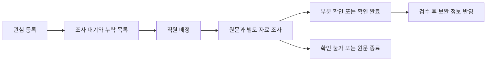

# 관리자 운영 기획

## P52 데모 임시 관리툴 (2026-10-02)

현재 관리자 화면과 수동 입력 대시보드는 데모 검증을 위한 임시 도구다. 공개 데모 배포는 정식 관리툴의 개발 완료를 의미하지 않는다. 데모 단계 종료 후 별도 업무로 정식 관리자 시스템을 개발한다. 역할별 권한, 초안 편집/삭제/검수/게시, 운영 모니터링과 백업/복원 검증을 포함한 범위는 그 단계에서 확정한다. 현재 실제 ADMIN 인증과 공개 데이터/검수 대기 초안의 분리는 유지한다.

사용자 정책: 관리툴 디자인은 제공되는 샘플을 기준으로 별도 작업한다. 기존 `/admin`이 있으므로 처음부터 전부 재작성하지 않는다. 샘플 수령/선택 여부는 GLI-046에서 확인한다. GS-021은 전체 운영 도구 통합 작업이다.

| 모듈 | 현재 재사용 부분 | 앞으로 연결할 업무 |
|---|---|---|
| 출처 | sources, 승인/중지 API, import form | 국가·필드 mapping·수집 범위·최근 성공/실패·비용 |
| 수집 | ingestion runs, raw snapshots, worker | on-demand 검색 저장, source별 확인, 실패 재처리 |
| 자산 | listings, review decisions, 공개 상태 | 원문/직원 보완 정보 분리, 자료작성 시점, gallery, 프로젝트 |
| 관심 조사 | favorites | 관심 이벤트→누락 항목 조사 task→직원 배정→증거 입력 |
| Trust | deterministic score/review | 8등급 근거·규칙 버전·검수 기록 |
| 회원 | users/memberships/usage | 실제 인증, 이용권/권한, 비용 통제 |
| Cash/결제 | checkout/webhook ledger | 선불 원장, 결제사 정산/취소/환불, 예외 처리 |
| 상담 | case/message/status/notification | 운영자 지정, 우선순위, SLA, 실제 공개 UI 연결 |
| 뉴스/공지 | 정적 콘텐츠와 route | 입력·미리보기·수정·카테고리·예약·게시·회수·삭제 |
| 감사/복원 | audit/readiness/backup evidence | 실제 운영 실행과 복원 증거, 권한별 조회 |

## 역할 제안

### P51 관리자 수동 입력 (2026-10-01)

`/admin/manual`에 기존 운영센터 스타일의 입력 폼과 최근20건 목록을 추가했다. 국가/도시/거래/유형/매물명/가격/통화/면적/설명과 선택 구역/침실/욕실/출처/이미지 링크를 받는다. 입력은 D1 `manual_asset_drafts`의 REVIEW_PENDING으로 저장하며 공개 listings/discovered_assets를 수정하지 않는다. 누락 침실/욕실은 null로 보존한다. 출처 미제공은 null이며 내부 정규화용 링크는 저장 출처에서 제거한다.

`POST /api/admin/manual-assets`는 실제 로그인/ACTIVE ADMIN/동일 Origin/JSON/16KB 검증을 요구하고 데모 계정 쓰기는 거부한다. 저장과 감사 기록은 atomic batch이며 요청키로 재시도 중복을 막는다. 입력자·시각을 기록하고 서버에서도 권한을 재검증한다. CSV/JSON 가져오기는 기존 source 화면을 유지한다.

이 단위는 입력/검수 대기 목록만 제공한다. 초안 편집/삭제/검수 증거 입력/공개 게시 연결은 별도 후속이다. 기존 listing review 화면이 이 새 초안을 바로 게시할 수 있다고 해석하지 않는다. 실제 관리자 로그인 시각/저장 종단 검수와 공개 배포는 별도다. Claude 원본/공개 화면은 수정하지 않았으며 운영센터에 수동 입력 링크만 추가했다.

2026-10-01 P50: DB 반입과 수동 입력은 가능하다. 기존 source별 CSV/JSON import form/API를 재사용하고 실제 ADMIN/source 승인/감사/입력 크기 제한을 유지한다. 공개 데모 계정은 반입 불가다. 새 수동 입력 UI와 게시 전 미리보기는 후속이며 아직 제작하지 않았다. SQL 실행·전체 DB 덮어쓰기 권한을 일반 관리자 화면에 열지 않는다. 자세한 연결 범위는 [D1 영속 저장](DURABLE-DISCOVERY.md)을 따른다.

GLI가 담당자를 지정한다. 역할 후보: 소스 운영자, 조사 담당자, 게시 검수자, 콘텐츠 편집자, 회원/상담 담당자, 재무 담당자, 시스템 관리자. 사람 수와 조직 구조는 미확정이다. API마다 최소 역할과 사용자/자산 범위를 명시한다. 역할 이름을 새 UI에 임의 반영하지 않는다.

## 관심 조사 목표 흐름

한 원문을 여러 회원이 저장하면 조사 task에 관심 수를 연결한다. 서로 다른 원문을 같은 주소라는 이유로 합치지 않는다. 직원 보완에는 작성자·근거·확인 시각·검토 상태를 저장한다. source 원문 값은 유지한다.

## 콘텐츠 목표 흐름

뉴스/공지는 draft → review → scheduled/published → unpublished/archived 형태로 관리한다. 예약 작업의 중복 실행과 수정 충돌을 처리하고 기존 URL을 유지한다. 삭제 방식과 보존 기간은 운영 정책으로 확정한다. 현재 하드코딩은 공개 데모 표현이며 게시 API가 구현되었다는 뜻은 아니다.

## 운영 정보 노출 경계

자료작성 시점, 내부 메모, 원문 snapshot 위치, 수집 실패 원인, 모델 비용은 관리자용이다. 공개 카드에는 승인된 자산 정보·출처 링크·등급 등만 전달한다. 내부 정보를 숨기기 위해 미확인 필드를 확인 완료로 바꾸지는 않는다.
