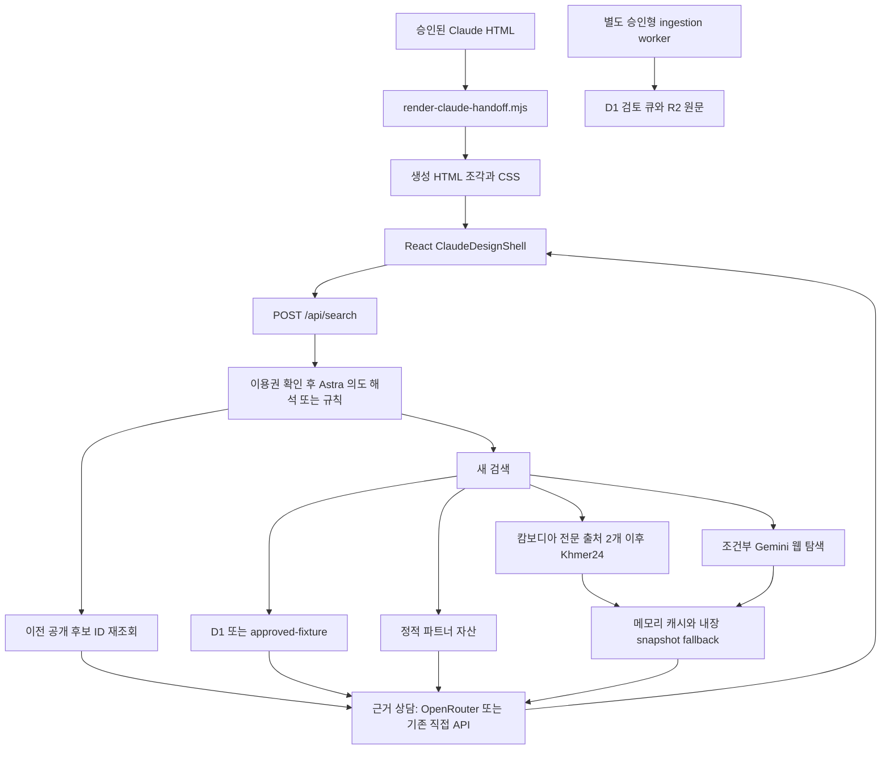

# 현재 상태와 데모 경계

## 2026-10-01 D1 후보 영속화 (P50)

검색/베트남 진단 collector 결과의 D1 저장과 상세/후속 참조 우선 복원을 연결했다. 실제 로컬 VN40건 저장 및 독립 D1 조회, 파일 재연결 시험 통과. 정규화 최신 후보 저장이지 원문 전체/백업/운영 검증 완료가 아니다. 공개 배포·관리자 수동 입력 UI는 아직 진행하지 않았다. [정확한 활성 조건과 미완료](DURABLE-DISCOVERY.md).

## 2026-10-01 다국가 상담 (P48)

첫 질문 국가 미지정은 KH/VN/PH, 후속은 이전 범위 유지/명시 변경 우선. 단일 국가 호환 countries 계약, 병렬 수집/실패 분리, 관측 FX 예산 비교 및 최대 통합5 후보를 로컬 구현했다. PHP/VND 예산과 매매/임대 동일 URL 분리 유지. 실제 검증·미완료·배포 경계는 HIST-20261001-009 및 MULTI-COUNTRY-SEARCH를 따른다. 국가별 전국 커버리지나 순수익 입증 완료가 아니다.

2026-09-08 코드 정적 점검. 공개 서버나 외부 포털의 오늘 동작을 확인한 보고서가 아니다.

## 2026-09-30 베트남 데모 매물 연결 (P45, 최신)

- 사용자 데모 재사용 승인과 Dot 매매/임대 필드 대조 후 제한 수집을 검색·상담/Map 상세에 연결. 실제 parser 시험 매매 20 + 임대 20. 원문 VND, 수집시각, 출처 URL 보존; USD 예산 판정은 확인된 환율이 있을 때만 수행.
- Homedy 매핑 timeout, Batdongsan 차단, ERA/IQI/미디어/지도 보류 유지. 원문 날짜/실제 순수입/전국 커버리지/영속 저장 확인을 뜻하지 않는다. 기존 번역 경로 재사용, UI/설정/키/유료 AI 검증 호출/공개 배포 없음.
- COUNTRY-SOURCES 및 HIST-20260930-006의 검증·미완료를 따른다.

## 2026-09-30 베트남 출처 선택 (P44, 이후 P45로 Dot 데모 보류 해제)

- 1차 검수 통과 출처만 활성화. Dot Property/Homedy는 접근 가능하나 재사용 조건/필드 매핑 미확정으로 보류하며, 현재 활성 베트남 collector는 0개다.
- ERA 보조자료 자동 수집 중단, IQI/미디어/지도 신규 연결 제외, 차단된 Batdongsan 반복 조회 중단. 별도 상태 API는 disabled 사유만 반환하고 외부/유료 AI 요청을 하지 않는다.
- UI·파트너 카드·캄보디아·설정/키·공개 배포 변경 없음. COUNTRY-SOURCES와 HIST-20260930-005를 따른다.

## 2026-09-30 베트남 데모 출처 (P43, 이후 P44로 보류)

- ERA 프로젝트 참조와 Batdongsan 데모 접근 점검을 별도 `GET /api/discovery/vietnam`으로 연결했다. ERA 공개 목록 12 프로젝트 확인; Batdongsan 서버 접근은 403이며 우회하지 않는다.
- 개별 매매·임대 추천/한국어 번역/영속 저장/주기 수집은 아직 연결하지 않았다. 가격 없는 프로젝트를 0원 매물이나 확인된 월수입 후보로 표시하지 않는다. UI·캄보디아·설정/키·공개 사이트 변경 없음.
- 상용은 명시적 승인 전 차단. 검증과 remaining은 COUNTRY-SOURCES 및 HIST-20260930-004를 따른다. 이 작업만 재개했으며 아래 P41의 시각/번역 backlog는 유지한다.

## 2026-09-23 작업 중단 지점

**P41 전체 일괄 작업은 보류 유지. 2026-10-01 번역/원화 실패 지시 범위만 재개했다.** P40의 혼합 문장·따옴표 명칭 보호·알려진 독립 지역명 표시 및 VND KRW 환산/저장 결과 복구를 구현했다(HIST-20261001-001). 유료 번역 실응답 전체, 사전 밖 지명, 구형 라벨은 미검증/미완료다. GLI-052-PROGRESS/RETURN와 상세 C1 등 다른 보류 업무는 확장하지 않는다. [확정 정책](DECISIONS.md)의 P40/P41 및 [다음 일괄 업데이트 목록](GLI-052-INTEGRATION-20260923.md)을 함께 읽는다.

직전 완료 코드는 HIST-20260923-017(232개 검사 통과)까지다. 018~026은 결함 확인·요구사항·정책/보류 기록이며 해당 기능의 구현 완료가 아니다. 로컬 코드/미커밋 변경은 그대로 보존했고 공개 배포하지 않았다.

## 2026-09-23 단계별 환경 결정

P37: 현재 GPT 사이트의 서버리스 목업을 먼저 개선하고, Google Cloud 테스트 서버에서 충분히 검증한 뒤 AWS 상용 버전으로 출시한다. 현재는 **1단계**이며 Google Cloud/AWS 이전은 실행하지 않았다. 구체 서비스·비용·이전 범위·검수 기준·배포 승인은 단계별로 확정한다. 코드가 존재하거나 로컬 빌드가 통과했다는 이유로 다음 환경이 준비됐다고 표시하지 않는다. [단계별 이전 계획](AWS-MIGRATION.md)을 따른다.

## 2026-09-18 OpenRouter 후속

2026-09-23 번역 표시 누락 보완(HIST-20260923-017): 외부 출처 없는 내장 데모 8건을 유료 번역 대상과 구분해 한국어 표시 사전에 연결했다. 현재 세션의 마지막 AI 답변/인용/후보도 동일한 제목으로 복원한다. review/clarify에서 기존 후보 순서를 유지하되 서버가 새로 번역한 같은 ID의 필드는 보존한다. 카드 면적·침실·욕실도 API 후보와 동기화했다. 마지막 결과 복구이며 전체 대화 영속화 완료는 아니다. 디자인 원본·공개 사이트 변경 없음.

2026-09-23 최종 시안 로컬 통합(HIST-20260923-016): 사용자 요청에 따라 GLI-052-R 상담 패널을 실제 검색 API에 연결했다. 최대 3건 요약/출처/접힌 이력/선택 자산 chip/모바일 M2/S1 새 답변 알림을 포함한다. 기존 원본 전페이지 교체가 아닌 상담 개선분 통합이며 상세는 [통합 계약](GLI-052-INTEGRATION-20260923.md)을 따른다. 문서의 이전 "미통합" 상태는 당시 기록이며 이 범위에서 대체된다. 커밋·푸시·공개 배포는 하지 않았다.

2026-09-23 상담 입력 복구(HIST-20260923-015): React 상태 갱신 때 승인 HTML DOM이 재생성되어 후속 입력이 첫 글자에서 끊기던 오류를 수정했다. 동일 HTML은 memo 경계에서 유지하고 기존 대화 행도 보존한다. 원본 시안의 대화 → 후속 입력창 순서를 복구하고 한글 IME 확정 Enter는 전송에서 제외한다. API/디자인 값/새 시안 통합/공개 배포 변경은 아니다.

2026-09-23 1단계 개선(P38): 검색의 의도/탐색/번역/상담에 D1 공통 운영 한도(전체 300회/일, 계정별 100회/일, 비로그인 공통 풀 100회/일)를 추가했다. 고객 횟수 복구와 실제 공급사 시도·토큰·비용 원장은 별개다. 목록/상세는 번역 캐시를 읽고 새 유료 번역은 보호된 검색에서만 실행한다. Gemini 동일 계정·동일 조건 동시 탐색 공유/실패 60초 cooldown, 브라우저 이탈 signal과 후속 유료 단계 중단, 긴 답변의 별도 재전송 문맥 제한을 구현했다. `npm run check`에 타입 검사를 포함한다. 상세 검증·적용 범위는 HIST-20260923-014와 [운영 보호 계약](AI-OPERATING-GUARD.md)을 따른다. 외부 후보의 영속 저장/최종 Claude 통합/공개 배포는 별개이며 미완료다.

2026-09-23 P36: 사용자 결정으로 Fable의 상담 참여 및 추가 유료 비교를 보류한다. 현재 실행은 Astra 의도 해석/상담과 Gemini 탐색 보조/번역을 유지한다. Fable 자동 검토는 원래 미구현이며 향후 필수 구현 항목으로 간주하지 않는다. 과거 시험 기록과 재사용 가능한 adapter는 보존하고 Claude Design 인계는 별개로 계속한다.

2026-09-23 로컬 실행 확인: 127.0.0.1:8776 서버를 복구하고 비로그인 로컬 opt-in에서 실제 Astra 상담과 브라우저 후보 3건 표시, Gemini 번역을 확인했다. Fable은 별도 합성 호출만 성공했으며 자동 검토 연결은 없다. Gemini 웹탐색은 HTTP 200이지만 시험 조건에서 0건, Khmer24 직접 수집은 robots 정책으로 snapshot이었다. 공개 배포나 새 Claude 시안 통합 상태는 바뀌지 않았다. 상세 증거: HISTORY의 HIST-20260923-005.

- P34: 별도 Gemini API로 외부 매물의 제목/요약/핵심 설명을 한국어 표시값으로 번역한다. 원문 필터 후 후보 최대 18건을 처리하고 목록·상세·상담에 동일 번역을 공급한다. R2에 원문/번역을 분리 보관해 같은 문장을 재사용하며 가격/통화/면적/ID/출처는 유지한다. 원본 디자인과 공개 배포는 변경하지 않았다. 저장·실패·다국어 범위는 PRODUCT-DATA의 GS-033 참고.

- P33: BuildBlock의 5턴 상담/상세 여정을 검토해 Claude 핸드오프 B1~B5를 보강했다. `previousAssetIds`를 공개 repository에서 재조회하고 Astra가 새 검색/이전 후보 검토를 구분한다. 후자는 수집 없이 표시 순서를 유지하며 해당 후보만 상담한다. source URL/detailFacts/checks를 공급하고 새 출처 URL 발명을 거부한다. 디자인/CSS/원본 HTML은 변경하지 않았으며 카드의 기존 DOM을 유지한 순서 연결만 수정했다.
- 실제 Astra 합성 2턴/최대 4회 시험: 두 번째 후보의 가격·출처·점유/대출 제약을 이어 설명하고, 총예산 6000만원/순수입 월100만원 변경 후 이전 두 후보만 비교했다. 기존 가격을 보존하고 비용/임대차 근거가 없어 순수익을 확정하지 않았다. 반환된 비용 합계 $0.1582675. 실제 매물의 투자 적합성 검증이 아니다.
- 남은 경계: 정적 시안 카드/상세의 일부 필드와 서버 ID 대응(C1), 장기·영속 상담 상태, 실시간 환율 필터, 검증된 계약/비용 자료, 선택 후보 UI와 모바일 상담 배치, 공개 체험 보호. 이번 작업으로 전체 상담 품질 또는 실서비스 준비 완료를 선언하지 않는다.

- P32 승인 후 로컬 주 상담 모델을 GPT-6 Astra로 설정했다. `consultation-intent.ts` → `consultation-search.ts`가 의도를 먼저 구조화/검증하고 실제 수집 및 검색 조건에 연결한다. 총예산/월수입 목표/거주 임대료가 분리되고 후속 조건을 보존한다. 공개 배포는 하지 않았다.
- 모델이 바꿀 수 없는 서버 지역 경계와 엄격 후보 필터를 사용한다. 완공·임차인 승계·가구·현금 매수는 조건 기억/상담 검토 대상이며 수집자료의 증빙 필터가 완성된 것은 아니다. 등록/공개 UI 파일은 변경하지 않았다.

- `lib/ai-search.ts`에 OpenRouter 상담 adapter가 추가되었다. `LLM_PROVIDER=openrouter`, `OPENROUTER_MODEL`과 서버 비밀값 `OPENROUTER_API_KEY`가 필요하며 모델 자동 대체는 사용하지 않는다.
- 사용자가 지정한 비교 대상은 Claude Fable 5.1과 GPT-6 Astra이다. Gemini는 기존 별도 API를 유지하며 이번 유료 비교에서 제외했다. 역할 자동 배정기나 크롤러 전체를 교체한 것이 아니다.
- 최근 최대 8턴, 동일 후보 자료, 동일 JSON 계약으로 비교한다. 내부 점수 대신 승인된 Trust 등급만 모델에 제공한다. 고정 검색 환율은 현재 환율로 답변에 쓰지 않도록 OpenRouter 입력에서 제외한다. 규칙 검색 자체의 고정 환율 문제는 남아 있다.
- 모의 시험과 실제 모델 비교는 [비교 실행 안내](OPENROUTER-COMPARISON.md)에 구분해 기록한다. 실패 후 규칙 답변을 반환한 경우 실제 모델 성공으로 세지 않는다.
- `GLI_LOCAL_AI_PREVIEW=enabled`는 비운영 환경의 loopback 요청에서 OpenRouter/OpenAI 상담 시험을 허용한다. 기존 Gemini 개발 모드는 보존한다. 공개 비로그인/무료 실제 AI 체험 방향은 승인됐지만 사용량/악용 방지 구현 전이므로 공개 이용권 게이트는 그대로다.
- 최초 비교는 키만 추가한 상태로 수행했고, 이후 P32 승인으로 로컬 모델을 Astra로 설정했다. 공개 사이트 설정과 배포는 변경하지 않았다.

## 실행 경로

## 확인된 주요 차이

| 영역 | 코드에 있는 것 | 아직 같은 것으로 간주할 수 없는 것 |
|---|---|---|
| UI | ClaudeDesignShell과 생성 원본 기반 화면, 최신 승인 개선 | 모든 화면이 실제 DB와 연결된 상태 |
| 탐색 | Astra 의도 해석/이전 후보 검토, 외부 후보 병합, 상담 API | 자율 3모델 배정, 영속 장기 기억, 검증된 수익 계산 도구 |
| 캄보디아 | 3개 출처 connector와 Gemini 제한 도메인 검색 | 오늘 각 출처에서 실제 수집에 성공했다는 증거 |
| 저장 | D1 저장소와 별도 ingestion 경로 | public live discovery의 모든 후보가 D1에 영구 저장됨 |
| 상세 | 원본 시안 ID는 생성 화면, 다른 ID는 getAsset 기반 화면 | 두 상세 화면의 완전한 시각·권한·데이터 통합 |
| 관심 자산 | D1 favorites API와 별도 목업 화면 | 현재 공개 하트가 항상 계정에 저장됨 |
| MY GLI | `/my` 구현이 존재 | 새 메뉴는 `coming-soon?section=my`로 이동하므로 완성된 공개 여정 아님 |
| 결제 | checkout/event 저장소와 데모 결제 화면 | 화면의 `setPaid(true)`는 실제 결제 승인 아님 |
| 뉴스 | 정적 newsItems, 시안 생성 기사, 승인된 추가 기사 | 운영자가 입력·예약 게시하는 CMS |
| Trust | 내부 점수 계산과 공개 8등급 매핑 | 모든 데모 등급이 실사 증거로 계산된 등급 |
| 환율 | 외부 환율 API와 원통화·환산 범위 UI | 탐색 예산 계산까지 동일 환율 사용: search.ts는 1380 고정값 |
| 운영 | admin/승인/감사/재시도/복원증거 코드 | AWS 배포, 실제 운영자 지정, 백업 복구 실증 |

## 탐색의 구체적인 제한

- `DATA_MODE` 기본값은 `approved-fixture`. 공개 환경이 D1인지 이번에 확인하지 않았다.
- public route는 최대 100개 저장 자산을 읽고 조건을 파싱한다. 전체 시장의 개수를 계산하지 않는다.
- `LIVE_CAMBODIA_DISCOVERY`는 서버 플래그와 실행 환경에 의존한다. 다른 국가에서는 호출하지 않는다.
- 전문 출처 두 곳은 병렬 요청하고 Khmer24를 뒤이어 호출한다. 초기 충분한 후보가 있으면 더 보기를 기다리는 정책은 아직 완전 연결되지 않았다.
- WordPress URL은 `per_page=30`, connector 기본 수용 건수는 20이다. Khmer24 기본 URL은 rentals 경로다. 매매/도시/페이지별 검색면을 완전히 커버하지 않는다.
- public discovery의 `rawStore.put()`은 아무것도 저장하지 않는다. Map 캐시는 대개 10분이며 재시작·인스턴스 변경 시 사라진다.
- 실패뿐 아니라 0건이어도 내장 snapshot이 반환될 수 있다. `snapshot`과 `collected`를 구분해야 한다. 원문 날짜와 이번 `checkedAt`는 같은 의미가 아니다.
- Gemini 웹 탐색은 캄보디아에서 엄격 일치 후보가 6건 미만일 때 조건부 호출된다. 기본 최대 10건, hard cap 12건이다.
- 최종 규칙 검색은 18건 제한이 있다. UI의 후보 수는 현재 표시 결과 수이며 출처 전체 매물 수가 아니다.
- 새 외부 후보는 같은 원문 URL 반복을 제거한다. 다른 포털의 유사 주소·사진 매물은 합치지 않는 정책을 유지한다. URL 전체 소문자화의 경로 충돌 가능성은 GS-007에서 추적한다.
- 원문 날짜가 없을 때 Gemini 후보에 현재 시각을 넣는 처리와 connector의 수집시각 사용은 신선도 요구와 다르다. GS-009에서 추적한다.

## 상담과 과금

OpenRouter 이용 가능 요청은 Astra의 구조화 의도와 서버 검증을 검색 전에 실행한다. 나머지 경로 또는 의도 실패는 `extractCriteria`를 사용한다. Gemini/OpenRouter 재전송 문맥은 최대 8턴, 턴당 1,200자 이내이며 질문은 800자까지다. 화면 답변 전문은 자르지 않는다. API는 이전 클라이언트의 긴 답변을 턴당 32,000자까지 받아 문맥으로 축약한다. 구조화 조건과 후보 ID는 별도 유지한다. 화면의 요청 이해/탐색/검토/답변 단계는 모델별 호출 증거가 아니다. 실제 provider 분기는 Gemini, OpenAI, OpenRouter, 규칙이다. 자율 도구 반복/역할 자동 배정은 아직 없다.

P38로 Gemini를 포함한 검색 유료 단계에 공통 일일 요청 한도를 추가했다. 금액 상한/분산 single-flight/공개 무료 신원/운영 대시보드는 GS-012에 남아 있다. 모델 이름 기본값은 코드의 현 상태일 뿐 실제 계정에서 지원·설정된 모델을 검증한 값이 아니다.

## 문서에서 바로잡은 과거 해석

- PM_BOARD의 'favorite limits'는 역사 표현이다. 현재 정책과 코드의 `favoriteLimit: null`은 관심 자산 무제한이다.
- DEC-014의 'raw conversation replay 없음'과 현재 8턴 전송은 다르다. 서버 장기 보관 정책은 별도 확정해야 한다.
- 과거 OpenAI 전용 readiness는 현재 Gemini 경로를 검증하는 충분한 기준이 아니다.
- 8월 source lock의 HTML hash와 현재 source hash가 다르다. 9월 선택적 개선 이력이 있으므로 이를 근거로 과거 파일로 되돌리지 않는다.
- 예전 완료표의 테스트 109개는 당시 기록이다. 이번에 그 테스트 전부를 다시 실행한 수치가 아니다.

새 작업 순서는 [기능 상태](FEATURE-STATUS.md), 구현 판단 기준은 [ACCEPTANCE.md](ACCEPTANCE.md)를 사용한다.
