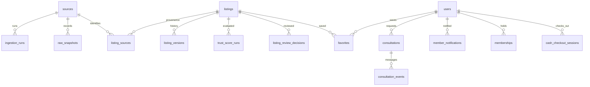

# 제품 정책과 데이터 구조

정책 근거: [DECISIONS.md](DECISIONS.md). 현재 물리 스키마는 `db/schema.ts`와 `drizzle/*.sql`이다. 아래 추가 모델은 목표이며 migration이 이미 있다는 뜻이 아니다.

## 분리해야 하는 세 축

P50: 외부 발견 후보 `discovered_assets`는 검증 listings와 분리한다. 원통화/출처 URL/거래 유형/최초·최근 관측 시각과 최신 공개 payload를 저장하며 실제 검증을 승격하지 않는다. [D1 저장 계약](DURABLE-DISCOVERY.md)의 보존·원문·백업·AWS 이식 경계를 따른다.

- 자산 유형: residential/commercial/leisure/project. 국가는 별도 필터.
- 공개 Trust: S/A+/A/B+/B/C+/C/D의 8등급. 내부 score와 검수 증거를 바탕으로 표시.
- 자산 열람: Free/Basic/Standard/Premium/Business 5단계. 높은 단계는 하위 단계를 포함. 회원 요금제와 별개.

| 회원 | 월 USD | 월 KRW | 연 할인 | 포함 열람 | 관심 등록 | 코드의 AI 월 한도 |
|---|---:|---:|---:|---|---|---:|
| Explorer | 1.99 | 3,000 | 10% | Basic | 무제한 | 60 |
| Investor | 2.99 | 4,500 | 15% | Standard | 무제한 | 150 |
| Private | 10 | 15,000 | 20% | Premium | 무제한 | 400 |

USD와 KRW 회원 가격은 승인된 별도 표시 가격이다. 자산 환율 API로 매번 멤버십 가격을 바꾸지 않는다. AI 한도는 현재 데모 설정이며 실서비스 비용 검토가 남았다.

GLI Cash는 여행과 모든 GLI 상품/편의서비스에 사용할 선불 캐시다. 멤버십 결제 원장 `cash_checkout_sessions`가 있다고 GLI Cash 잔액 원장이 구현된 것은 아니다. 충전·사용·취소·환불·동시성·잔액 일치 모델은 GS-018. 이후 코인 결제는 별도 수단이며 Web2 캐시와 혼합하지 않는다.

## 현재 관계

P51 `manual_asset_drafts`: id/actor_user_id/input_hash/payload_json/status(REVIEW_PENDING)/created_at. users와 입력자를 연결하고 audit_logs에 생성 행위만 기록한다. 공개 자산/검증 등급과 분리하며 임의 source 승인은 발생하지 않는다. migration0019와 db/manual-assets 계약 참조.



도식은 도메인 관계 요약이다. 정확한 FK·키 타입·제약은 스키마와 migration을 읽는다. SQL에 `fingerprint`/`changed_fields_json`이 남아도 포털 간 자동 병합이나 사용자용 변경 비교를 구현하라는 요구가 아니다.

## 이식할 모델과 누락된 구조

| 영역 | 현재 | 목표/추가 작업 |
|---|---|---|
| 원문 식별 | sourceId + externalKey unique | 같은 원문 갱신, 다른 원문 독립 |
| 가격 | Asset.price, maxPrice, currency; DB priceMinor | Decimal/minor 단위 정의, 범위 끝값, 월/총액/면적단가, nullable 가격 |
| 위치 | country/city/district 문자열 | source 원문과 정규화 위치 ID 분리, 국가별 별칭 |
| 미제공 값 | 일부 0/문자열/탈락 | field value=null + missing reason; zero/studio/미상 분리 |
| 날짜 | observedAt/updatedAt 혼합 | sourcePostedAt/sourceModifiedAt/collectedAt/lastCheckedAt/verifiedAt/documentDate 분리 |
| 매물 종류 | Asset.propertyType는 condo/house/villa, 일부 검색은 land/commercial도 허용 | 자산 4분류와 부동산 subtype/project 모델 정합성 |
| 원문 증거 | R2 adapter와 raw snapshot ledger | public discovery도 같은 영구 증거 경로 사용 |
| 프로젝트 | 정적 partnerAssets/detailFacts | 프로젝트·호실·가격범위·파트너 문서 관계 |
| 자료 열람 | 데모 단계와 full report gate | 자료별 required tier, 유효기간, 구매/환불 권한 |
| 직원 보완 | review ledger 일부 | field research record, 출처/검증값 공존 |
| CMS | newsItems와 시안 HTML | news/article revision/media/scheduling |
| 검색 작업 | 요청 안에서 실행/Map | search job/result/source run/cancel/failure status |

## 외부 매물 번역 (P34 / GS-033)

`lib/asset-localization.ts`는 원문 Asset을 수정하지 않고 공개 표시용 복사본을 만든다. 제목, 요약, 강점, 확인 항목, detailFacts의 외국어 및 혼합 언어 문자열이 대상이다. 한국어만 있거나 통화 코드/URL만 남은 문구는 호출하지 않는다. 정규화된 위치 필드/프로젝트 고유명사는 재작성하지 않는다. 구조화 가격·통화·면적·ID·URL·등급·날짜·이미지는 번역 응답으로 덮어쓰지 않는다.

- 검색은 원문으로 필터링한 후 반환 후보 최대 18건을 6건씩 번역한다. 상세는 1건, 목록 API도 외부 대상 최대 18건/요청이다. 대규모 목록은 이후 페이지 단위로 확장한다.
- 기존 별도 Gemini API 사용. `GEMINI_TRANSLATION=disabled`로 중지, `GEMINI_TRANSLATION_MODEL` → `GEMINI_MODEL` → `gemini-3.7-flash` 순으로 선택한다. 비밀키는 기존 `GEMINI_API_KEY`만 서버에서 사용한다. AI Studio에 별도 프롬프트 저장은 필요 없다.
- R2 `FILES`의 비공개 `asset-translations/asset-ko-v2/{sha256}.json`에 원문 필드 배열/한국어 배열/원문 URL/언어/모델/번역 시각/버전을 함께 저장한다. 키는 원문 URL·번역 대상 문자열·언어·모델·버전 기반이다. 수집시각만 바뀌면 재사용하고, 원문 문자열 변경 시 새 레코드를 생성한다. 호환되는 v1 레코드는 원문 필드/수치/보호 토큰 검증 후 재사용하여 재번역 비용을 줄이며 이전 버전은 덮어쓰지 않는다.
- 메모리 캐시 최대 500건, 같은 프로세스 동시 요청 병합, 실패 60초 재시도 억제. R2 장애 시 원문 또는 프로세스 캐시로 계속 표시한다. R2 미연결 시 재시작 후 재사용을 보장하지 않는다. 서버 간 동시 호출 잠금, 정리/보존 정책, 운영자 번역 교정 UI/D1 색인은 후속 작업이다.
- 숫자/통화 코드·기호/URL과 따옴표로 묶인 전체 명칭은 플레이스홀더로 보호하고 복원 후 동일성을 검사한다. 알 수 없는 ID/필드, 누락/중복, HTML, 변경된 숫자는 거부한다. 의미상의 오역 전체를 기계적으로 보증하는 검사는 아니며 운영자 검수가 필요하다.
- `locale=ko` 기본, `en`은 원문 반환. 영어 원문 반환은 한국어 GLI 자체 문구까지 영어로 바꾸는 전체 다국어 지원이 아니다. 새로운 언어 선택 UI는 만들지 않았다.
- 번역 완료는 원문 재수집 성공이나 권리/수익 검증을 의미하지 않는다. 기존 public discovery 원문의 영속 저장 미완료(GS-004)와 구별한다. 공개 체험 전체 비용/남용 제한(GS-012)도 별도다.

### 2026-09-23 표시 누락 보완

- 현재 화면에서 확인된 영문 3건(GLI-KH-101/102/106)은 외부 원문 URL이 없는 내장 데모 자산이었다. 외부 Gemini 번역 대상과 구분한다. `lib/demo-asset-localization.ts`가 알려진 데모 8건의 ID와 원 제목이 모두 일치할 때만 한국어 표시 제목을 제공한다. 원 Asset/가격/위치/출처는 변경하지 않고 출처 URL을 만들어 붙이지 않는다. `en`은 원문, Gemini 비활성화는 이 무비용 사전 표시까지 금지하지 않는다.
- 검색/목록/서버 상세의 공통 localizeAssets에 이 투영을 연결한다. 검색 상담 모델에도 한국어 제목이 전달된다. 기존 정적 시안 상세는 별도 C1 정합성 과제다.
- `localizeDemoResult`는 이전 세션의 확인된 데모 원 제목만 AI 답변·후보·인용 라벨에 치환한다. 사용자 발언/일반 영문/외부 원문은 임의 번역하지 않는다. 새로고침 시 sessionStorage의 마지막 결과·AI 답변만 복구하며 전체 대화 영속 저장을 의미하지 않는다.
- review/clarify는 이전 목록의 ID·순서를 유지하면서 같은 ID로 서버가 반환한 최신 필드(번역 포함)를 적용한다. 이전 객체 전체로 덮어써 번역을 버리지 않는다. 이 화면의 면적·침실·욕실도 같은 후보 값으로 갱신한다.
- 외부 신규 번역은 P38의 metered 검색에서만 실행한다. 목록/상세는 번역 캐시 또는 원문만 사용한다. 이 보완 검수는 실제 유료 Gemini 호출 없이 모의 응답·브라우저·기존 사용자 화면으로 수행하며, 모든 외부 매물의 번역 성공을 보장한다는 뜻은 아니다.

## 필드 계약 제안

### 2026-10-01 지역명·원화 표시 기능 복구 (GS-013/033)

- `location-display`는 알려진 독립 지역명을 한국어로 투영한다. country/city/district 원문·정규화 값은 필터용으로 유지하며 카드·상세·조건 칩만 표시 라벨을 사용한다. 제목의 쉼표/문장부호로 분리된 알려진 지역명도 변환하되, 따옴표 전체 명칭/붙여 쓴 명칭/구분 없는 복합 브랜드는 보존한다. 사전에 없는 지명은 추측해서 바꾸지 않는다.
- 검색 결과 카드와 TOP3는 동일한 `candidateConverted`를 사용한다. USD만 처리하던 제한을 제거하고 VND 등 지원 통화의 원 가격/가격범위 양 끝을 공유 FX의 원통화→USD→KRW로 환산한다. 원 가격은 유지한다. 신규 검색 응답은 조회된 snapshot을 상담·표시에 전달하며, 상세의 임시 FX 실패는 이후 방문의 재조회를 차단하지 않는다.
- 기존 sessionStorage 결과는 무료 FX GET과 결정적 표시 투영으로 복구한다. 새 상담/번역 유료 요청을 발생시키거나 기존 AI 설명을 재생성하지 않는다. 기존 답변/추천 이유에 남은 영어 문장 및 환율 미확인 설명이 자동으로 모두 정정된다는 뜻은 아니다.
- 혼합 언어 번역은 metered 검색에서만 실행하고 공개 상세/목록은 캐시만 읽는다. 유료 공급자 실응답 검증은 이번 작업에서 하지 않았다. 규칙 KRW 예산 해석의 1380 고정값·언어 메뉴·전체 지명 사전·구형 상세 문구는 남은 과제다.
- 후속 실제 테스트(HIST-20261001-002)는 카드/TOP3 한국어 지명·원화 표시를 확인했지만 상담 본문은 원화 환율이 없다고 답했다. OpenRouter 입력에서 FX가 누락된 것을 찾아 후보별 계산된 KRW 참조/관측 환율/한국어 위치 라벨을 추가했다. 수정 후 전달 계약은 모의 시험으로 확인했으며 실제 새 답변은 추가 유료 실행 전까지 미검증이다. 본문/추천 이유의 District 1/2, An Phu 잔존을 완료 처리하지 않는다.
- P46: 환율은 사용자 입력 조건이 아닌 GLI API 책임이다. 관측 환율이 없더라도 사용자에게 환율을 묻지 않는다. 원 가격을 유지하고 일시 환산 불가로 처리한다. 최대23시간 캐시라는 현재 최신성 경계는 남아 있으며 초단위 실시간 완료로 표현하지 않는다.

```ts
// TARGET ONLY. 현재 Asset 타입을 교체하지 않은 설계 예시.
type EvidenceField<T> = {
  value: T | null;
  state: "source_present" | "source_missing" | "fetch_failed"
    | "not_applicable" | "staff_confirmed";
  sourceRecordId: string;
  evidenceId: string | null;
  checkedAt: string | null;
  verifiedAt: string | null;
};
```

`source_missing`은 사용자에게 '조사 예정'. 나머지 상태의 상세 UI 문구는 승인 시안을 확인한다. 수집 실패를 '출처에 원래 없음'으로 바꾸지 않는다.

## 공개와 관리자 데이터

| 데이터 | 공개 | 관리자 |
|---|---|---|
| 자산명·지역·원 가격·통화·사진·공개 등급 | 승인 UI대로 | 원문/정규화 값 확인 |
| 외부 출처명·원문 매물 링크 | 실제 외부 매물에 제공 | external ID/수집 방식 포함 |
| 원문 게시 나이 | 승인된 배지 | 원문 날짜/변경/체크 시각 분리 |
| 문서작성 시점·등록 근거·검토 메모 | 카드 반복 설명에 넣지 않음 | 전체 확인 가능 |
| source 신뢰 순서·모델 공급사·프롬프트 | 표시 안 함 | 권한 있는 운영자만 |
| 상세 자료 | 자료별 열람권 | 게시/회수/검토 권한 |

자료에 없는 실제 정보는 직원 조사를 기다린다. 사용자 승인 데모 문구는 내부에 데모 근거를 남기고 이후 실데이터 교체 대상으로 추적한다. 이번 문서화는 공개 문구를 교정하는 작업을 포함하지 않는다.
